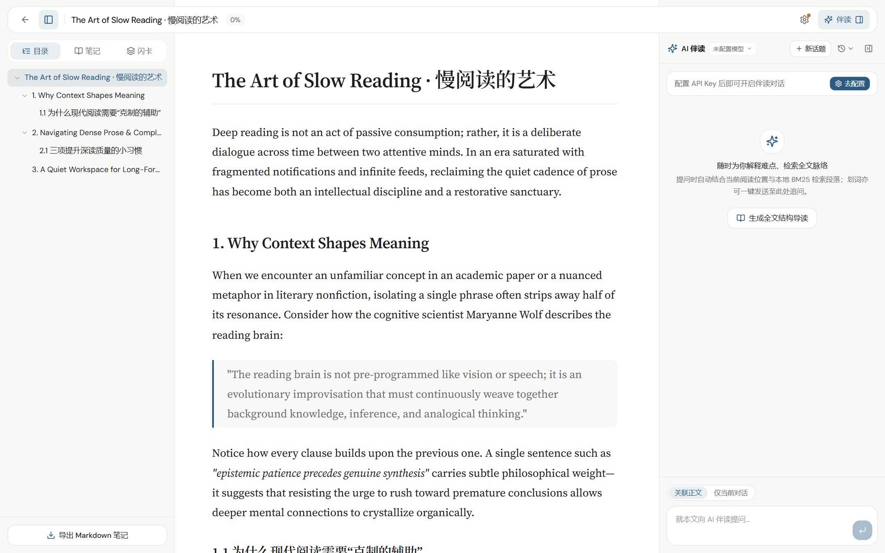
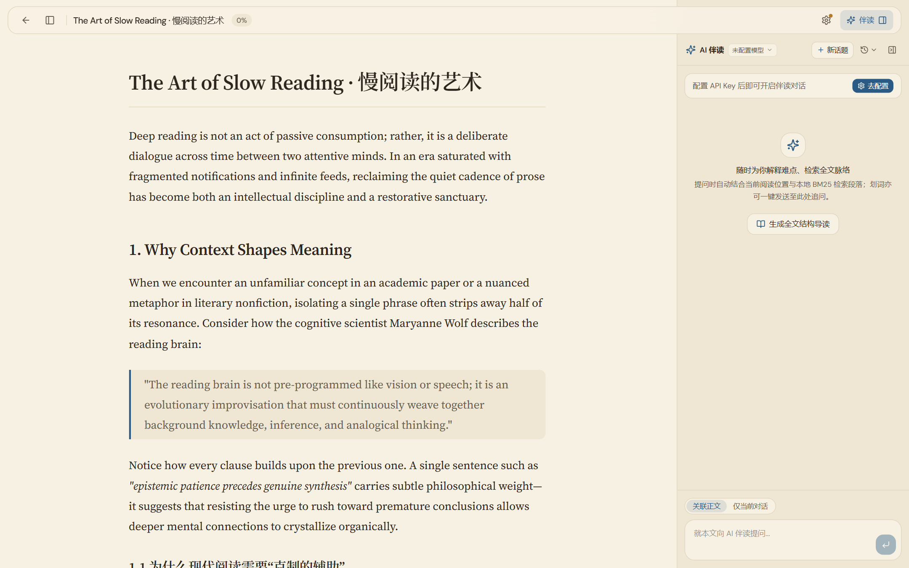
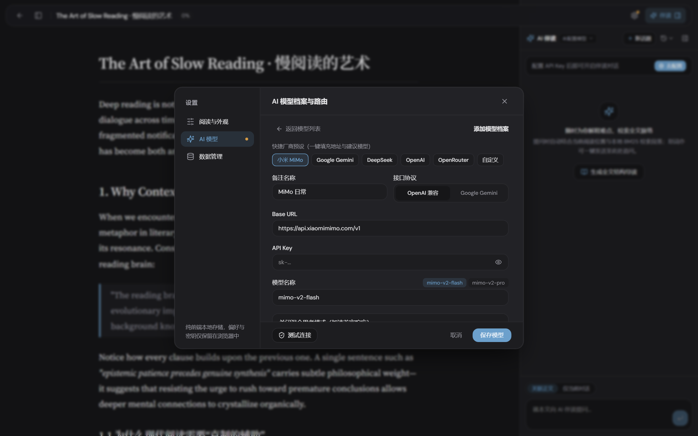

# Lumina Reader

> 安静地阅读，自然地思考——极致极简、注重排版体验与低侵扰 AI 伴读的本地文档阅读器（支持在线 Web 与 Tauri v2 桌面端）。

🌐 **在线体验（零登录 · 内置双语示例文档）**：[https://xsnj-9527.github.io/lumina-reader/](https://xsnj-9527.github.io/lumina-reader/)  
📦 **Windows 桌面安装包**：[GitHub Releases](https://github.com/xsnj-9527/lumina-reader/releases/latest)  
📊 **检索评测与 Badcase 拆解**：[docs/EVAL_AND_BADCASES.md](./docs/EVAL_AND_BADCASES.md)


---

## 界面预览

| 纯白专注阅读 + 目录与 AI 伴读 | 暖黄护眼主题 |
| :---: | :---: |
|  |  |

| 暗黑深灰 + 多模型预设（内置小米 MiMo） | 本地书库首页 |
| :---: | :---: |
|  |  |

---

## 本地检索评测与 Badcase 治理

无需外部向量库或重型 Embedding 模型，Lumina Reader 纯前端实现 **当前阅读视窗 + BM25（英文词干归并 + 中文双字 n-gram）混合检索**。内置零额外依赖评测脚本（`npm test` / `npm run eval`），在 14 章节 + 9 附录中英文混合技术文档（8,855 字符 / 24 分块、预算上限 2,800 字符）上实测对比结果如下：

| 检索策略 | 总命中率（20 条） | 局部指代问答（6 条） | 跨章检索（14 条） |
| :--- | :---: | :---: | :---: |
| 无索引头部截断 | 8 / 20（40.0%） | — | — |
| 纯 BM25 检索 | 16 / 20（80.0%） | 2 / 6 | 14 / 14 |
| **视窗 + BM25 混合（Lumina）** | **20 / 20（100.0%）** | **6 / 6** | **14 / 14** |

- **上下文控本**：平均单次输入 **2,590 字符**，相比全文输入节省 **70.8%** 上下文开销；34,876 字符超长文档导读自动抽样压缩至 **13,932 字符**（上限 15,000）。
- **边界回归**：PDF 跨行断词与中文碎空格清洗 **8 / 8 PASS**，划词模式自动分流与 Prompt 约束 **6 / 6 PASS**。详见 [docs/EVAL_AND_BADCASES.md](./docs/EVAL_AND_BADCASES.md)。

---

## 核心特性

- **四格式纯本地解析**：
  - **PDF**：基于 `pdfjs-dist` 渲染，开启文本层支持精准划词、目录导航与归一化三色高亮叠层，暗黑模式下可选「柔和反色」或「低亮原色（保护彩色论文图表）」。
  - **EPUB**：原生流式 DOM 解析（非 `<iframe>`），支持 EPUB3 `nav.xhtml` 与 EPUB2 `toc.ncx` 目录、书内章节跳转及统一图片排版，完整接入划线笔记与检索。
  - **DOCX**：通过 `mammoth` 解析并重排为舒适的流式阅读视图。
  - **Markdown**：基于 `react-markdown` + `remark-gfm` 渲染，代码块支持语法标签与一键复制。
- **书卷排版与三套护眼主题**：
  - 纯白、暖黄护眼、暗黑深灰三套主题，配合纯本地打包的开源可变字体（Source Serif 4 / Newsreader / DM Sans），支持字号、行高、版心宽度实时调节。
- **指尖划词翻译与语境词典**：
  - 自动清洗 PDF 跨行断词与连字符，按单词/术语与长句智能分流为「语境词典」或纯正「原位译文」，支持一键存为双语笔记或送入右侧栏继续追问。
- **零外部向量库本地索引与多话题伴读**：
  - 基于纯前端 BM25 + 中文双字 n-gram 检索，自动拼装当前视窗与最相关段落，严格控制上下文开销；支持按需全文导读缓存、多话题持久化、主动回忆闪卡及批注管理。
- **多模型档案库与场景独立路由**：
  - 支持自由添加与管理多条 OpenAI 兼容或 Google Gemini 模型档案（内置小米 MiMo、Google Gemini、DeepSeek、OpenAI、OpenRouter 与本地端口预设），可分别为「伴读答疑」与「划词翻译」指定不同模型，并支持关闭混合思考模式以加速首字响应。
- **数据私密与一键轻量备份**：
  - 书籍、笔记、批注、闪卡与对话仅保存在本地浏览器 / WebView IndexedDB 中，支持一键导出/合并恢复 `.json` 备份（严格不导出任何 `apiKey`）。
- **Tauri v2 桌面体验**：
  - 接入 `@tauri-apps/plugin-http` 彻底消除桌面端 AI 请求跨域限制；内置外部链接拦截默认浏览器打开、窗口状态记忆以及全局 `ErrorBoundary` 兜底。

## 技术栈

- **前端框架**：Vite + React 19 + TypeScript + Tailwind CSS v4 + Lucide Icons
- **文档解析**：`pdfjs-dist`、`jszip`、`mammoth`、`react-markdown`、`remark-gfm`、`dompurify`
- **本地持久化**：`idb` (IndexedDB v2) + `localStorage`
- **桌面端外壳**：Tauri v2（`tauri-plugin-http`、`tauri-plugin-opener`、`tauri-plugin-window-state`）

## 快速开始

### 环境准备

- Node.js 20+ 与 npm
- 若需编译或开发桌面端，请先安装 [Rust 工具链](https://www.rust-lang.org/) 与系统对应的 Tauri v2 构建依赖（Windows 下为 WebView2 与 Visual Studio C++ 生成工具）

### 安装依赖与运行评测

```bash
npm install

# 运行本地检索对比评测 + 划词清洗与 Prompt 分流测试（34 项校验）
npm test
```

### Web 模式开发与构建

```bash
# 启动本地开发服务器
npm run dev

# 类型检查与生产构建
npx tsc --noEmit
npm run build
```

### Tauri v2 桌面端开发与打包

```bash
# 启动桌面端热重载调试窗口
npm run tauri dev

# 构建正式桌面安装包（Windows 下生成 NSIS .exe 安装器）
npm run tauri build
```

## 隐私与安全说明

- 所有文档文件、阅读进度、高亮批注与对话记录均存储在用户本地设备。
- AI API Key 仅存储在本地 `localStorage` 中，直接请求用户指定的模型接口；数据导出功能不会包含任何密钥信息。
